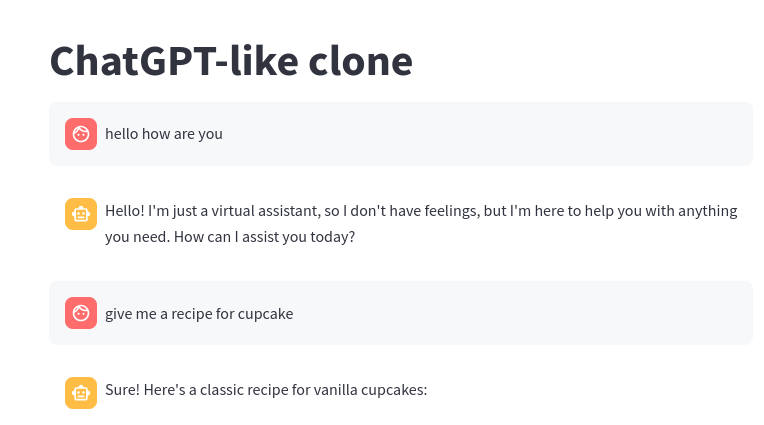

# Build and Deploy LLM Apps

We will build, package and deploy a sample LLM app

We will use [streamlit](https://streamlit.io/) framework to build nice, easy UIs

## 1 - Setup

This is a self-contained [uv](https://docs.astral.sh/uv/) project.  Sync the environment

```bash
uv  sync
```

Copy `.env.sample` into `.env` and populate your API keys

```bash
cp   .env.sample   .env
```

## 2 - Inspect the Code

Using Replicate [chat_app1_replicate.py](chat_app1_replicate.py)

Using OpenAI [chat_app1_openai.py](chat_app1_openai.py)

## 3 - Launch app

### 3.1 - Replicate

```bash
uv  run  streamlit  run chat_app1_replicate.py
```

### 3.2 - OpenAI

```bash
uv  run  streamlit  run chat_app1_openai.py
```

This will open a browser.  Or go to the default url: http://localhost:8501


## 4 - Containerize the app

For this step, you will need to have [Docker](https://www.docker.com/) installed and setup on your machine.

### 4.1 - Env file

The app reads API keys from a `.env` file in this directory (created during setup — see Step-1).

If you have not created it yet

```bash
cp   .env.sample   .env
```


### 4.2 - Build Docker

```bash
docker build .  -t llm-app
```

You can check the docker image details as follows

```bash
docker  images | grep llm
```

output may look like

```text
REPOSITORY              TAG             IMAGE ID       CREATED         SIZE
llm-app                       latest               6c85f9a56c2f   16 seconds ago   1.54GB
```

## 5 -  Running the Docker


```bash
docker run  -p 8501:8501 llm-app
```

This will start the app.  You can access the UI here :   http://localhost:8501

Here is the screenshot fo the application



## (Optional) Bonus lab 1 : Update the Example to use Ollama

Make a copy of `chat_app1_replicate.py` and modify it to use local Ollama server.

## (Optional) Bonus lab 2: Deploy the Container

Now the app if fully containerized, it can be deployed at any Cloud / Container service.

You can publish the image to Dockerhub or other cloud container repos.

And deploy from there.